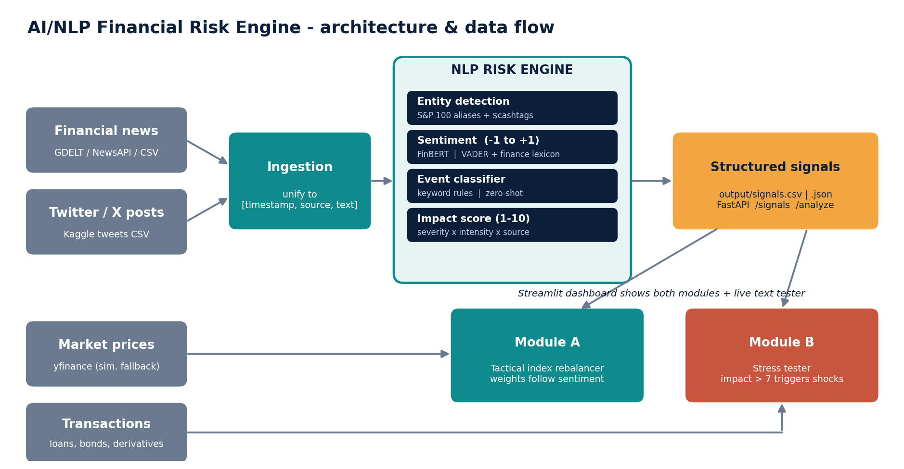
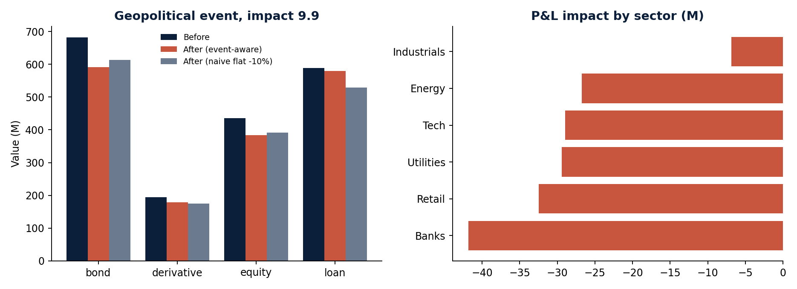
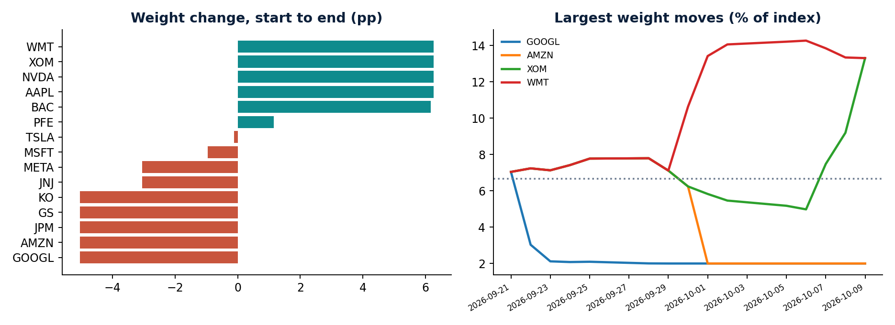

# AI/NLP Financial Risk Engine - S&P Global & Crisil Campus Hackathon

**Candidate Name:** Nikhil Chauhan
**College Email ID:** iit2023217@iiita.ac.in
**College / Campus:** IIIT Allahabad
**Demo Video Link:** To be added
**Slide Deck Link (if hosted externally):** Included in repo: [`docs/presentation.pdf`](docs/presentation.pdf)
**GitHub Repository:** [github.com/Nikhilchauhan331/Hack](https://github.com/Nikhilchauhan331/Hack)

## 1. Project Overview / Problem Statement & Approach
Market-moving information arrives as unstructured text (news, social media) faster than analysts can read it.
This project builds a **unified AI/NLP Risk Engine** that ingests text from two sources (financial news and Twitter/X-style
posts) and converts it into structured, machine-readable signals per company or event: a **sentiment score** (-1 to +1),
an **event classification** (Geopolitical, Macroeconomic, Credit Event, Merger/Acquisition, Product Launch, plus Earnings,
Regulatory/Legal, Other) and an **impact score** (1-10). Signals are written to CSV/JSON and exposed via a small FastAPI.

To show the engine is useful, **both** downstream modules are implemented:
* **Module A - Tactical Index Rebalancing:** a 15-stock mock S&P 100 index whose weights rise on positive and fall on negative
  sentiment (smoothed, impact-weighted, capped at 2-15% per stock), compared with an equal-weight benchmark.
* **Module B - Strategic Portfolio Stress Testing:** when an event with **Impact > 7** is detected, shocks scaled by severity
  are applied to a synthetic portfolio of loans, bonds, derivatives and equities; the dashboard shows value before/after
  by asset class and sector.

## 2. Architecture & Tech Stack


* **Language/libs:** Python, pandas, numpy, Streamlit + Plotly (dashboard), FastAPI (API), yfinance (prices), requests.
* **NLP:** pluggable sentiment back-ends - **VADER + finance lexicon** (offline-safe default), **FinBERT** (`ProsusAI/finbert`, optional and explicitly enabled), or a built-in lexicon (zero-dependency fallback).
  Event classification: keyword rules (default), **zero-shot** `facebook/bart-large-mnli`, or hybrid. Select with `SENTIMENT_BACKEND` and `EVENT_BACKEND`.
* **Impact score:** `clip((event base severity + intensity words + 2*|sentiment|) * source reliability, 1, 10)` (news 1.0, tweets 0.7).
* **Explainability:** each signal lists its `drivers` (the words that moved sentiment/event).
* **Module B shock model:** equity drop, rate/spread shift (bonds via duration), PD multiplier (loans via PD x LGD), delta-equivalent loss (derivatives); all scaled by `impact/10`.

```
src/
  main.py                 CLI: run engine / --live / --eval / --backtest
  app.py                  Streamlit dashboard
  risk_engine/            ingest.py, nlp.py, engine.py, api.py, evaluate.py
  modules/                rebalancer.py (A), stress_test.py (B), prices.py, backtest.py
  make_sample_data.py     regenerates synthetic data
  make_figures.py         regenerates docs/architecture.png and result charts
data/                     all datasets used (see data/README.md)
tests/test_engine.py      unit tests
docs/                     presentation.pdf/.pptx, architecture.png, results, demo script
```

## 3. Dataset Used
* **Synthetic** news headlines, tweets and a wholesale-banking transaction portfolio (generated by `src/make_sample_data.py`), plus public price data via Yahoo Finance (`yfinance`).
* Assumptions: sentiment/events are mapped to a 20-company S&P 100 subset; unmatched text is tagged `MARKET`; Module B treats market-wide events as hitting the whole portfolio; ratings-to-PD and LGD (45%) are standard textbook simplifications.
* The engine also accepts GDELT, NewsAPI and the Kaggle datasets named in the problem statement. Details in [`data/README.md`](data/README.md).
* No proprietary, client or S&P Global / Crisil data is used.

## 4. Quickstart & Installation
Runtime: **Python 3.10+** (tested on Windows with Python 3.10.11; also developed for Python 3.12/Linux).

```bash
git clone https://github.com/Nikhilchauhan331/Hack.git
cd Hack
python -m venv venv
venv\Scripts\activate            # Windows   (Mac/Linux: source venv/bin/activate)
pip install -r requirements.txt

python src/main.py               # 1) run the engine -> output/signals.csv + signals.json
streamlit run src/app.py         # 2) dashboard (signals, Module A, Module B, live text tester)
```

Optional extras:
```bash
python src/main.py --live                      # also pull live GDELT (+ NewsAPI if NEWSAPI_KEY is set)
pip install -r requirements-finbert.txt        # optional; then explicitly enable:  set SENTIMENT_BACKEND=finbert
set EVENT_BACKEND=hybrid                       # zero-shot events when keyword confidence is low (Mac/Linux: export)
uvicorn risk_engine.api:app --app-dir src      # API docs at http://127.0.0.1:8000/docs
python src/main.py --eval                      # sanity-check labels on data/eval_labeled.csv
pip install -r requirements-dev.txt            # test tooling
pytest tests                                   # core unit tests
python src/make_figures.py --simulate-prices  # regenerate docs images offline
```
No internet? Tick **"Use simulated prices (offline)"** in the dashboard sidebar (or add `--simulate-prices` to CLI commands).
The default sentiment backend is offline-safe VADER; FinBERT is opt-in with
`SENTIMENT_BACKEND=finbert` and may download a model.

## 5. Key Results & Domain Impact
**What it demonstrates (offline sample run, synthetic data):**
* 84 structured signals from 2 sources; 22 with impact > 7.
* Sanity check on 41 hand-labelled texts with the default zero-dependency lexicon back-end: sentiment accuracy 75.6%
  (76.3% on positive/negative only); event labels matched 100% on the news rows. **Caveat:** the set is small and written by the author
  alongside the rules, so this is a smoke test, not a generalisation claim. FinBERT is expected to improve sentiment but was not measured here.
* Module B (Geopolitical event, impact 9.9) on a 1,899M synthetic portfolio: 166.3M loss (8.76%); bonds 90.6M, equities 51.7M, derivatives 15.5M, loans 8.5M.
  A naive flat -10% shock would give 189.9M and misstate the mix by asset class.
* Module A moved weights within the 2-15% caps (e.g. WMT +6.4pp, GOOGL -4.7pp) on simulated prices.




**Why it matters:** risk, portfolio and treasury teams get early, explainable, quantified reactions to news events instead of reading
headlines manually; the same signals drive both tactical (index weights) and strategic (stress test) decisions.

**Limitations / next steps:** heuristic impact calibration, rule-based events, simplified shocks, no VaR; next: calibrate impact against returns (`--backtest` hook is ready), streaming ingestion, dedup and source credibility. Sample data can be reproduced with `SAMPLE_DATA_SEED=7` and `SAMPLE_DATA_END_DATE=2026-10-10`.

---
*AI usage disclosure: this project was built with AI assistance (Anthropic Claude) for code scaffolding, documentation and slides; the author reviewed, ran and is responsible for the submission.*
